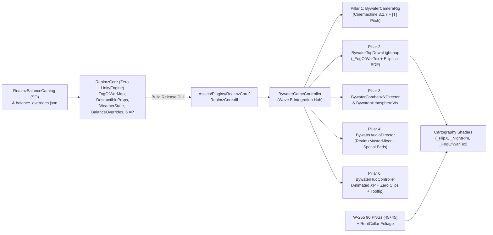

# Realmz Remastered - Stage 2 Visual & Unity Gameplay Master Plan (`C:\realmz`)

**Owner:** W-256 (Principal Game Designer & Unity Systems Architect)  
**Target Branch:** `origin/Remaster` (`HEAD` at `14f7d04a8faddd06256c64eb2255c4bb533974a0`; `main` strictly untouched at `21a951ce3356a01306d0f12e5c0d0c76670387e8`)  
**Engine & Stack:** Unity `6000.0.85f2` (URP `17.0.4`, Cinemachine `3.1.7`, InputSystem `1.20.0`, TextMeshPro, Test Framework `1.6.0`), pure deterministic `RealmzCore` (`netstandard2.1`, ZERO `UnityEngine` dependencies)  
**Performance Target:** `< 3.0 ms` average frame-time addition over M1 baseline, `>= 60 FPS` (`<= 16.6 ms` total frame time) at `1920x1080` PC URP quality, zero per-frame GC allocations in combat/exploration loops  

---

## Locked `#direct` Game Design & Architectural Invariants

1. **Genre North Star:** Tactical Survival RPG (Day/Night torchlight survival, biome/water ecology, scouting, finite bandages/torches, meaningful rations/weather friction).
2. **Action Points (`AP`):** Fixed base `6 AP` per turn (strictly NOT modified by Agility or Fatigue), up to `+2 AP` carryover via `CombatActionEconomy` (`RealmzCore\Rules\CombatRules.cs`); Equipment Sets (`ScoutsLeather`, `IronVanguard`, and M2 sets) and gear grant AP and Free Move bonuses.
3. **Victory Screen:** Option 2 Pure Selectable Loot (`4`-across compact cards, default selected, inline stats, green up-arrow `Hero` class-valid tags, gold up-arrow & heart-cross symbols beside `Lv`, Gold Coins icon, zero `MVP`, manual equip in `[P]`).
4. **Core Architecture:** Pure deterministic `RealmzCore` (`C:\realmz\remaster\RealmzCore\RealmzCore.csproj`) maintains strictly ZERO `UnityEngine` dependencies. All Unity gameplay glue talks to `RealmzCore.dll` (`Assets/Plugins/RealmzCore/RealmzCore.dll`).
5. **Standalone Player Safety:** Keep strictly one `MonoBehaviour` per `.cs` file named identically to its class so Windows Standalone builds (`Realmz.exe`) never hit `level0` deserialization corruption.
6. **Git Branch Safety:** All commits and pushes target `origin/Remaster` only (`main` stays untouched at `21a951c`).

---

## Section 1 - Executive Overview & Design Cohesion

### 1.1 Unifying Stage 2 Visual Polish & 6 Gameplay Pillars

Realmz M1 proved the foundational HD-2D stack: `64 px/m` texel-locked terrain (`CartographyTerrain.shader`), `+Y` normal-mapped billboards (`CartographyBillboard.shader`), drifting FBM cloud lightmaps (`BywaterTopDownLightmap`), and a responsive `RealmzCore` tactical engine with Pre-Battle Deployment and unified `6 AP` economy. However, `realmz_art_director_audit.md` and live codebase inspection revealed that M1 still feels visually uneven and tactically under-feedbacked in six linked ways: hollowed/glare props and fallback fences/columns break diorama believability, flat `1.40-1.50` Night Combat ambient strips torchlight tension, an `Orc Warrior` (`1-8 HP`, default `4`) dies faster than a `Giant Frog` (`3-24 HP`), combat rivers look like pasted blue grid squares, `com.unity.cinemachine 3.1.7` and `Unity AudioMixer` sit completely unused, and terrain/destructible combos lack tactile payoff.

Stage 2 solves these **together as one Tactical Survival RPG system**:
- **Visual Readability Drives Tactical Survival (Track 0 + Pillar 2):** Fixing the 5 hollowed buildings/props/trees, importing all 30 new Grade-A biome props/decals (`W-255`), implementing normal-safe `_FlipX`, `MaterialPropertyBlock` tint/scale variance, `0.5x` ground-skirt decals + `RootCollar` foliage rings, real continuous `IsWater` combat rivers, and Night Combat moonlight rim separation makes every piece of cover, elevation bluff, and hazard instantly legible. Layering real **3-State Fog-of-War (`Unseen / Explored / CurrentlyVisible`)** onto `_TopDownLightmapTex` ties scouting (`Kaelen`/`Vex`) and Aldric's Torch radius directly to what the player can perceive at Night and inside `dungeon_0`.
- **Kinesthetic Impact Teaches Emergent Systems (Pillars 1, 3, 5):** Upgrading `BywaterCameraRig` to `Cinemachine 3.1.7` (`CinemachineImpulseSource`, `[T]` smooth `48 <-> 64 deg` tactical pitch toggle, Level-Up/AoE focus beats) paired with `~40ms` hit-stop, arcing pixel arrows, glowing Fireballs, hop-by-hop `Water` chain lightning, and `oil_keg_cluster` / `LitBrazier` chain-reaction detonations turns positional play (`Shove [V]`, High Ground, Elemental Surfaces) into visceral cause-and-effect.
- **Living Audio & Progression Polish Completes the Fantasy (Pillars 4 & 6):** A real `Unity AudioMixer` (`1.5s` music crossfades across all `11` music suites, spatial river/forge/torch ambient beds, `+/- 8%` pitch jitter across all `142` SFX) plus animated Victory XP fill-up bars popping the gold up-arrow (`snd_3002_level_up`), hover outlines on interactive doors/NPCs/kegs, and hot-tunable `RealmzBalanceCatalog` (`ScriptableObject` + `balance_overrides.json`) unify town exploration, survival resource pressure, and tactical combat into a Grade-A vertical slice.

### 1.2 System Architecture & Decoupled Boundary Flow



### 1.3 Unified Performance Budget (`< 3.0 ms` Delta, `>= 60 FPS` @ `1920x1080`)

| Subsystem | CPU Budget (ms/frame) | GPU Budget (ms/frame) | Hard Guardrail / Allocation Policy |
| :--- | :---: | :---: | :--- |
| **3-State Fog-of-War & Lightmap** | `<= 0.10` | `<= 0.15` | Dirty-flag `_FogOfWarTex` upload only on tile step / torch toggle (`90x90` RGBA32); `50ms` blit throttle on `_TopDownLightmapTex` |
| **Track 0 Foliage & Root Collars** | `<= 0.25` | `<= 0.35` | `Graphics.DrawMeshInstanced` (`1023`/batch) + `16x16` frustum chunk culling; zero runtime mesh rebuilds per frame |
| **Pillar 3 Combat & World VFX** | `<= 0.25` | `<= 0.40` | Pre-allocated pools (max `16` projectiles, `4` chimney smoke emitters `4-6 p/s`, `8` brazier embers `8-12 p/s`, `1` rain system `max 220`); zero `Instantiate`/`Destroy` in combat |
| **Pillar 1 Cinemachine 3.1.7** | `<= 0.12` | `0.00` | Single `CinemachineBrain` + 1 active `CinemachineCamera`; deterministic impulse array reuse |
| **Pillar 4 AudioMixer & Spatial Beds** | `<= 0.15` | `0.00` | `8` pooled SFX voices + `2` music crossfade sources + max `3` spatial ambient sources (`Streaming` `.ogg`, `DecompressOnLoad` `.wav`) |
| **Pillar 6 UI Micro-Feedback** | `<= 0.25` | `<= 0.15` | Only active during Victory modal `0.65s` XP tween or hover change; zero layout rebuilds when idle |
| **RealmzCore Sim + Destructibles** | `<= 0.20` | `0.00` | Fixed-grid flood/LOS evaluation only on discrete step/action; zero LINQ/GC churn |
| **Total Added Stage 2 Delta** | **`<= 1.32 ms`** | **`<= 1.05 ms`** | **Combined `< 2.4 ms` avg (`< 3.0 ms` ceiling), preserving `>= 60 FPS` (`<= 16.6 ms`) on RTX 5060 Ti** |

---

## Section 2 - Detailed Expectations & Acceptance Criteria

### Track 0 - Stage 2 Grade-A Art, Shader & Balance Convergence

#### 0.1 `W-255` 45-Asset Pack Import & Biome Obstacle Replacement
- **Verified Art Pack Inputs (`c:\Users\karti\LifeTwin\scratch\realmz_grade_a_art_pack\output\`):** `45` primary PNGs + `45` OpenGL `+Y` Laigter normal maps (`*_n.png`) = `90` PNGs (`grade_a_art_manifest.json`).
  - **Part 1 Repairs (`15` assets):**
    - `Buildings/`: `building_temple.png` (`320x320`), `building_apothecary.png` (`288x256`).
    - `Props/`: `prop_stone_ruins.png` (`160x144`), `prop_market_stall_a.png` (`160x144`), `prop_barrels_crates.png` (`128x112`), `prop_wooden_wagon.png` (`192x144`), `prop_stone_well.png` (`128x144`).
    - `trees/`: `tree_pine_b.png` (`192x256`), `tree_oak_a.png` (`224x224`), `tree_pine_a.png` (`192x256`).
    - `Portraits/`: `portrait_npc_priestess.png` (`128x128`, gritty painterly replacement matching Blacksmith/Tanner/Apothecary).
    - `tiles/`: `meadow_grass.png`, `dirt_road.png`, `river_mud.png`, `cliff_rock.png` (`128x128` seamless tiles + periodic `_n.png` packed into `CartographyTerrainAlbedoArray.asset` & `CartographyTerrainNormalArray.asset`).
  - **Part 2 Biome Cover, Animated `4f` Props & Ground Decals (`30` assets -> `Assets/Art/Cartography/`):**
    - `trees/`: `gnarled_dead_tree.png` (`192x224`).
    - `Props/` (single-frame): `boulder_moss_a.png` (`96x96`), `boulder_moss_b.png` (`112x96`), `boulder_moss_c.png` (`80x80`), `fallen_hollow_log.png` (`160x80`), `thorn_bramble_thicket.png` (`96x80`), `ruined_wall_corner.png` (`128x128`), `broken_archway.png` (`192x160`), `rubble_pile_a.png` (`96x80`), `rubble_pile_b.png` (`112x80`), `fallen_statue.png` (`160x96`), `bone_pile.png` (`80x64`), `iron_cage.png` (`96x128`), `dungeon_floor_grate_rusted.png` (`96x96`, flat floor), `palisade_stakes.png` (`128x96`), `cart_wreck.png` (`192x128`), `hay_bale.png` (`96x80`), `oil_keg_cluster.png` (`96x80`), `town_notice_board.png` (`128x144`), `wooden_plank_bridge.png` (`192x128`), `driftwood_snag.png` (`128x80`), `half_sunk_rowboat.png` (`160x96`).
    - `Props/` (`4f` strips, `512x128` = `4 x 128x128`, `Multiple` sprite slice in `CartographyAssetImporter`): `rune_obelisk_4f.png`, `town_lantern_post_4f.png`, `river_reeds_4f.png`.
    - `Props/` (`FloorDecal`, `0.5, 0.5` center pivot): `decal_moss_skirt.png` (`96x96`), `decal_pebbles.png` (`96x96`), `decal_fallen_leaves.png` (`96x96`), `decal_cracked_stone.png` (`96x96`), `decal_shore_foam.png` (`128x64`).
  - **Import QA Note on `W-255` Output:** `grade_a_art_manifest.json` reports `44/45` QA pass solely because `decal_pebbles` scored `guide_coverage=0.32` (expected for sparse pebble clusters; `grade_a_terrain_decals_sheet.png` confirms clean 18-color pebble clusters with zero holes/magenta bleed). Wave B must verify all 90 PNGs, check `W-255` final output if rerolled, ensure `Point` filter / `Uncompressed` / `MipMap OFF` / `64 PPU` / `NormalMap + sRGB OFF` for `*_n.png` (and update `CartographyAssetImporter.ConfigurePngImporter` so `decal_*.png` and `dungeon_floor_grate_rusted.png` use `Center (0.5, 0.5)` pivot).
- **Replace Arena Fallbacks (`CartographyWorldData.ApplyCombatArenaLayout`):**
  - `BoulderRock` -> `BoulderMossA` / `BoulderMossB` / `BoulderMossC` (never `StoneFenceH` / `DungeonPillar`).
  - `RuinedWall` -> `RuinedWallCorner` / `BrokenArchway` / `RubblePileA` / `RubblePileB` (never `StoneFenceH` / `DungeonPillar`).
  - `BrushThicket` -> `ThornBrambleThicket` (`1.5m x 1.25m`, never shrunken `TreeOakB`).
  - Biome dressing & props: `DeepWoods` (`FallenHollowLog`, `GnarledDeadTree`), `RoadAmbush` (`PalisadeStakes`, `CartWreck`, `HayBale`, `OilKegCluster`), `RiverbankCrossing` (`WoodenPlankBridge`, `RiverReeds4f`, `DriftwoodSnag`, `HalfSunkRowboat`), `RuinsOutskirts` & `DungeonChamber` (`FallenStatue`, `RuneObelisk4f`, `BonePile`, `IronCage`, `DungeonFloorGrateRusted`), `Town` (`TownNoticeBoard`, `TownLanternPost4f`).

#### 0.2 Procedural Variety & Shader Multipliers
- **Normal-Safe `_FlipX` (`CartographyBillboard.shader` + Renderers):**
  - Add `_FlipX ("Flip Horizontal (0/1)", Float) = 0.0` to `Properties`, non-instanced `CBUFFER`, and `UNITY_INSTANCING_BUFFER_START(Props)`.
  - In `ComputeBillboardAtlasUV`: compute `float flipX = CARTO_INST_PROP(_FlipX);` and invert `localUV.x` BEFORE cell `lerp(uvMin, uvMax, ...)` so 4-frame strips and 2-bank foliage atlases never bleed across frame boundaries.
  - In `BillboardFrag`: `if (CARTO_INST_PROP(_FlipX) > 0.5) { normalTS.x = -normalTS.x; }` so directional sunlight, torches, and moonlight rim always illuminate the facing edge accurately.
  - `BywaterUnitView.SetFacingRight`: keep `localScale.x = 1f` and write `_FlipX` via `_spritePropBlock` (`0f` right, `1f` left).
  - `BywaterWorldRenderer.RebuildCartographyProps`: set deterministic `FlipX` (`(DeterministicHash(gx, gy, (int)prop.Kind * 31) & 1) == 1`) on natural/rubble/cover props (`Tree*`, `Boulder*`, `Log`, `Bramble`, `Rubble*`, `BarrelsCrates`, `RuinedWallCorner`, `Decal*`). **Never** flip `StoneBridge`, asymmetric town buildings (`IsTallBuildingPropKind`), or `Signpost`.
  - `BywaterFoliageScatter.BuildBatchesFromLists`: supply `float[] batchFlipX` (`50%` deterministic flip per grass/fern card).
- **`MaterialPropertyBlock` Value, Tint & Scale Jitter (`BywaterWorldRenderer`):**
  - Add `BaseTint`, `BaseScale`, `FlipX`, and `ContactShadowRenderer` to `PropBillboardEntry`; preserve `entry.BaseTint * alpha` across `UpdateTreeOcclusionFade` and `ApplyAnimated4FramePropertyBlock` (never clobbering with `Color.white`).
  - Tight Sunlit-128 linear multipliers:
    - **Trees (`Oak`, `Pine`, `Willow`, `GnarledDeadTree`):** `scaleX 0.88-1.14`, `scaleY 0.86-1.18`, `val 0.86-1.07` (Oak warm `(0.96-1.06 R, 0.96-1.05 G, 0.90-1.00 B)`, Pine cool `(0.88-0.98 R, 0.95-1.04 G, 0.96-1.06 B)`).
    - **Boulders:** `scaleX 0.84-1.15`, `scaleY 0.85-1.12`, `val 0.86-1.06`.
    - **Ruins, Walls & Statues:** `scaleX 0.94-1.06`, `scaleY 0.92-1.08`, `val 0.88-1.04`.
    - **Crates, Barrels, Rowboats, Carts:** `scaleX 0.92-1.08`, `scaleY 0.92-1.07`, `val 0.88-1.05` (with slightly desaturated wood multiplier `(0.90, 0.86, 0.80)` on `half_sunk_rowboat` so yellow wood reads river-weathered).
- **`0.5x` Ground-Skirt Decals, Contact Shadows & Root Foliage Collars:**
  - Spawn `FloorDecal` quads at `elev + 0.015f` (`ShadowCastingMode.Off`, random `FlipX` + `0/90/180/270` Y-rotation): `DecalFallenLeaves` / `DecalMossSkirt` (`1.2m-1.6m`) under trees/logs, `DecalPebbles` / `DecalCrackedStone` (`1.1m-1.4m`) under boulders/ruins, and `DecalShoreFoam` along `RiverbankReed` banks; plus pooled `PropContactShadow` quads (`elev + 0.010f`, `0.85 * SizeMeters.x`) under upright props and buildings.
  - Add a dedicated `RootCollar` pass in `BywaterFoliageScatter`: scatter `4-8` `0.50m` foliage cards in a `0.36m-0.50m` perimeter ring around non-road `HasRootCollar` obstacle tiles without breaking `CartographyEditorTests.BywaterFoliageScatter_ScattersDenseMeadowCardsAndRespectsExclusions` (`GetTileCardCount` stays `0` on `BlocksFoliage` / road / bridge / inn tiles while `RootCollarCardCount` exposes the perimeter collar ring count).

#### 0.3 Chamfered Shorelines, Road Shoulders, Cliff Breakup & Real `IsWater` Combat Rivers
- **Smooth Overworld Shorelines (`BywaterTopDownLightmap` + `CartographyWater.shader`):**
  - Replace box-clamped `minLandDist` in `BywaterTopDownLightmap.ConfigureFromWorldData` with rounded/elliptical corner SDF + a `3x3` Gaussian smoothing pass on `_worldStaticMap.g` (keeping `openMidRiver.g < 0.5`, `nearBank.g > 0.5`, `openLand.g == 1.0` for `CartographyEditorTests`).
  - Perturb `distToBank` in `CartographyWater.shader` with `64 px/m` quantized multi-frequency wave noise (`Hash21(floor(snappedWS * 16.0)) * 0.07 + sin(snappedWS.x * 3.5 + snappedWS.y * 2.7) * 0.04`).
- **Feather Cobble Road Borders & Break Cliff Banding:**
  - Lower `CartographyWorldData.CobbleElevation` from `0.04f` to `0.025f` (`<= 0.03f` cliff threshold in `BywaterElevationBuilder.CheckAndEmitCliff`) so cobblestone paths blend naturally via `_NoiseMaskStrength` and `decal_pebbles` instead of emitting square 90-degree rock steps.
  - In `CartographyTerrain.shader` (`ComputePixelLockedUV`): add `rawUV.y += CartoHash12(floor(positionWS.xz)) * 0.37;` on steep cliff faces (`absN.y < 0.55`) and deepen base crease AO from `lerp(0.55h, 1.0h, creaseAO)` to `lerp(0.45h, 1.0h, creaseAO)`.
- **Real `IsWater` River Combat Tiles & Corner-Tick Grid Cleanup:**
  - In `CartographyWorldData.ApplyCombatArenaLayout`: set `RiverbankCrossing` water tiles to `tile.IsWater = true` at `RiverElevation = -0.28f` (with `WaterSurfaceHeight = -0.18f`) so the continuous `CartographyWater.shader` river plane flows seamlessly through combat arenas; place `WoodenPlankBridge` props on `BridgePlank` crossings and `RiverReeds4f` + `DecalShoreFoam` along `IsMudBank`.
  - Keep `SurfaceType.Water` gameplay rules unchanged in `RealmzCore`. In `BywaterGridOverlays`: suppress opaque `surface_water` square stamps on `tile.IsWater` river tiles, elevate `ElectrifiedWater`/`Ice`/`SteamCloud`/`Fire`/`Oil` overlays to `Mathf.Max(GetTileElevation(x, y), WaterSurfaceHeight) + 0.025f`, replace solid cyan square grid outlines with subtle `20%` alpha corner-tick `L`-brackets (`#38BDF8` reachable / `#FACC15` attack-move / `#EF4444` AoO), and display step `1 AP`/`2 AP` pips along the hovered move path.

#### 0.4 Night Combat Chiaroscuro + Moonlight Rim Lighting
- **Rebalance `BywaterBiomeAtmosphere.BuildCombatNightState`:**
  - `ambientIntensity`: `1.40-1.50` -> `0.98` (unlit) / `1.08` (lit torch).
  - `sunIntensity`: `0.88-0.98` -> `0.68` (unlit) / `0.78` (lit torch).
  - `shadowStrength`: `0.30` -> `0.48`; `contrast`: `6` -> `15`; `postExposure`: `+0.22..+0.28` -> `+0.06` (unlit) / `+0.10` (lit torch); `tonemapping`: `ACES` to preserve deep midnight shadows and warm brazier highlights.
- **Moonlight Rim Separation (`CartographyBillboard.shader`):**
  - Add `_NightRimColor ("Moonlight Rim Color", Color) = (0.659, 0.733, 0.878, 1)` (`#A8BBE0`), `_NightRimStrength ("Local Night Rim Multiplier", Range(0, 2)) = 1.0`, plus global float `_GlobalNightRimStrength` updated by `BywaterBiomeAtmosphere` (`0.0f` Day/Dawn, `0.28f` Dusk, `0.55f` Night / Combat Night, `0.35f` Dungeon).
  - Compute Fresnel rim in `BillboardFrag`: `half rim = pow(1.0h - saturate(dot(normalWS, viewDirWS)), 2.2h) * (half)(_GlobalNightRimStrength * _NightRimStrength); color += albedo * _NightRimColor.rgb * rim;` (adds crisp cool silhouette edge against dark ground while keeping torch pools warm and contrasty).

#### 0.5 Monster Balance Inversion, Shopkeeper Scale & HUD Text Clip Fixes
- **Monster HP & Role Fix (`realmz-exporter/bywater_m1.py` + `monsters_bywater_m1.json` + `balance_overrides.json`):**
  - `orc_warrior`: `hit_dice: 3`, `hp_bonus: 3` -> `hp_min: 18`, `hp_max: 24`, `hp_default: 21`, `xp_reward: 65`, telegraphed **2-tile Cleave** floor warning.
  - `giant_frog`: `hp_min: 15`, `hp_max: 19`, `hp_default: 17`, `xp_reward: 70`, **Tongue Pull** tactical displacement capability.
  - `goblin` (`Goblin Raider`): `hp_min: 8`, `hp_max: 11`, `hp_default: 9`.
  - `goblin_archer`: `hp_min: 6`, `hp_max: 9`, `hp_default: 8` (prioritizes high-ground bluffs).
- **Shopkeeper Scale Fix (`BywaterWorldRenderer.RebuildCartographyNpcs`):**
  - Change `spriteSize: 2.0f` (`BywaterWorldRenderer.cs:1228`) to **`1.20f`** (target range `1.15f-1.25f`) so Borin, Tanner, Apothecary, and Priestess read at authentic `~1.65m` human scale beside Aldric instead of towering half-giants.
- **Zero Clipped HUD Strings (`BywaterHudController.cs` & `BywaterWorldRenderer.cs`):**
  1. `Short Swor` (`BywaterHudController.cs:2823-2843, 5146-5147`): enable `enableAutoSizing = true` (`fontSizeMin = 10.5f, fontSizeMax = 14f`) on `HotbarSlot` labels + concise `ShortenWeaponName` dictionary (`"Short Sword" -> "Short Swd"`, `"Broad Sword" -> "Broadswd"`).
  2. `Giant Fro` (`BywaterHudController.cs:4586, 4608-4609`): widen `InitCard` `preferredWidth` (`160f -> 184f`), enable `enableAutoSizing` (`11f..14.5f`), and display compact role badge (`Tank`/`Skirm`/`Rng`/`Ctrl`).
  3. `...for 12 t` & `[Theron] Approach & Melee: Giant Fro` (`BywaterHudController.cs:3011, 4735-4897`): enable word-wrap (`TextWrappingModes.Normal`) on `CombatTickerPanel` / `CombatLogDrawer` rows and expand `CursorTooltipPanel` width (`min 360f`, dynamic up to `440f`) with `NoWrap` title auto-sizing (`13f..16f`).
  4. `Shared Stash` & `NpcInteractPrompt` (`BywaterHudController.cs:1464, 1537` & `BywaterWorldRenderer.cs:1291`): shorten stash row string to `"{shortName} x{qty}{chgTag} [{sellPrice}g] - {compactStats}"` with `enableAutoSizing` (`11.5f..14.5f`), widen `NpcInteractPrompt` from `280x44` to `330x46` with `enableAutoSizing` (`11.5f..15f`), and replace empty `SP -` on non-casters (`Aldric`, `Kaelen`, `Vex`) with an `AP` / `Guard` badge.

#### Track 0 Acceptance Criteria
- All 45 `W-255` primary PNGs + 45 `_n.png` normals imported with `Point`, `Uncompressed`, `MipMap OFF`, `64 PPU`, zero interior alpha holes on buildings/trees/stalls/ruins, and zero fallback `StoneFenceH`/`DungeonPillar` boulders in wild arenas.
- Directional lighting illuminates the facing side of West-facing (`_FlipX = 1`) and East-facing (`_FlipX = 0`) units/props identically; trees/rocks exhibit natural tint/scale jitter and ground-skirt decals + root foliage collars.
- River combat arena displays live animated `CartographyWater.shader` river tiles seamlessly matching overworld water; cobblestone paths show feathered pebble transitions with zero square cliff curbs.
- Night Combat `ambientIntensity` measures `[0.95f, 1.12f]` with active moonlight rim separation (`_GlobalNightRimStrength >= 0.50f`); `Orc Warrior` spawns with `18-24 HP` vs `Giant Frog` `15-19 HP`; shopkeepers spawn at `1.20f`; zero clipped text in screenshots.

---

### Pillar 1 - Combat Juice & Camera Drama (`com.unity.cinemachine 3.1.7`)

- **Technical Architecture (`Realmz.Runtime.asmdef` + `BywaterCameraRig.cs`):**
  - Add `"Unity.Cinemachine"` to `Assets/Scripts/Realmz.Runtime.asmdef`.
  - Mount `CinemachineBrain` alongside `Camera` and attach a driven `CinemachineCamera` + `CinemachineImpulseSource` + `CinemachineImpulseListener` on `BywaterCameraRig` (creating components programmatically in `Awake` if missing in test scenes so existing EditMode/PlayMode tests never fail on missing scene wiring).
  - Preserve 100% of existing public APIs (`GridToWorld`, `ComputeCombatFraming`, `FrameCombatantsInSafeViewport`, `ApplyScrollZoomDelta`, `ApplyPointerDragPan`, `ApplyKeyboardPanInput`, `PlayImpactImpulse`, `ScreenPointToGridCoord`, `DefaultSafeViewportRect`).
- **Combat Juice & Feel Specs:**
  - **Hit-Stop (`~40ms`):** `TriggerHitStop(0.040f)` on normal heavy melee/shove impacts (`0.055f` on crits, `Fireball`, `oil_keg_cluster`, and cliff crush), cleanly bypassed when `SpeedIndex == 2` (`Instant`) or `Application.isBatchMode`; `StopHitStopAndRestoreTimeScale()` guarantees `Time.timeScale` never leaks across combat exits.
  - **Directional `CinemachineImpulse` Screen Shake:** Extend `PlayImpactImpulse(float strength, float duration, Vector3? directionWorld = null)` to fire a directional velocity impulse (`directionWorld.normalized * strength`) into `CinemachineImpulseSource` (`0.11m` hit / `0.19m` crit / `0.24m` `Shove [V]` wall/ledge impact / `0.26m` `Fireball` or `oil_keg_cluster` blast, damped `0.15s-0.22s` envelope).
  - **Focus Beats:** Add `PlayFocusBeat(Vector3 worldPos, float zoomDelta = -1.6f, float holdSeconds = 0.45f)` for multi-target AoE detonations, Level-Up pops, and elite boss intros; smoothly transitions back to `FrameCombatantsInSafeViewport` after `holdSeconds`.
  - **Smooth `[T]` Tactical Pitch Toggle:** Pressing `[T]` in combat calls `BywaterCameraRig.ToggleTacticalPitch()`, smoothly interpolating `pitchDegrees` between **`48.0 deg`** (Scenic HD-2D Diorama) and **`64.0 deg`** (Steeper Tactical Overhead) over `0.32s` (`SmoothStep`) while continuously re-evaluating `ComputeCombatFraming` so all units remain inside `DefaultSafeViewportRect` without overlapping `TacticalActionBar` or `InitiativeRibbon`.

#### Pillar 1 Acceptance Criteria
- `BywaterCameraRig` exposes `IsTacticalPitchActive`, `CurrentPitchDegrees` (`48f` or `64f` +/- `0.5f` after `0.35s` toggle), and `ActiveCinemachineCamera != null`.
- `PlayImpactImpulse` and `PlayFocusBeat` work cleanly in both `M1_Bywater_Slice` and isolated unit test GameObjects with zero errors, and `[T]` toggle keeps every combatant inside `DefaultSafeViewportRect`.

---

### Pillar 2 - Real 3-State Fog-of-War & Torchlight Vision

- **Pure `RealmzCore` Visibility Engine (`RealmzCore\Exploration\FogOfWarMap.cs` + `ExplorationSession.cs`):**
  - Define `public enum FogVisibilityState : byte { Unseen = 0, Explored = 1, CurrentlyVisible = 2 }`.
  - Maintain per-map `FogOfWarMap` state (`Width x Height` byte grid) inside `ExplorationSession` (ZERO `UnityEngine` deps!).
  - Recompute active shadowcast / Bresenham LOS visibility on session start, every tile step, portal transition, and Torch light/extinguish (`ComputeVisibilityRadius()`):
    - **Day / Dawn:** `11` tiles base (`+2` = `13` when conscious `Ranger` or `Rogue` is in party).
    - **Dusk:** `8` tiles (`10` with lit Torch).
    - **Night (unlit):** `4` tiles (`DARK DANGER!`); **Night (lit Torch):** `9` tiles.
    - **`dungeon_0` (unlit):** `3` tiles; **`dungeon_0` (lit Torch):** `8` tiles.
  - Previously `CurrentlyVisible` tiles demote to `Explored` when out of sight range; `Unseen` stays `0`.
- **GPU Texture & Shader Integration (`BywaterTopDownLightmap` + Shaders + `BywaterWorldRenderer`):**
  - `BywaterTopDownLightmap.SetFogOfWarData(byte[] states, int width, int height, bool enabled)` packs `states` into an `RGBA32` `Texture2D` (`_FogOfWarTex`, `Bilinear`, `Clamp`, `R = 0.0 / 0.45 / 1.0`, uploaded only on dirty hash change `< 0.1ms`) and sets global `_FogOfWarEnabled` (`0` for `BywaterDiorama_Proof` 18x18 diorama, `1` for `M1_Bywater_Slice` gameplay).
  - `CartographyTerrain.shader`, `CartographyWater.shader`, and `CartographyBillboard.shader` sample `_FogOfWarTex` at `lmUV`:
    - `Unseen (0.0)`: dark ink shroud (`#0D101B` charcoal-indigo tint, `0.08` brightness floor).
    - `Explored (0.45)`: `55%` desaturated cool slate memory fog (`0.42` brightness) showing static terrain, roads, rivers, and discovered town buildings.
    - `CurrentlyVisible (1.0)`: `100%` crisp full lighting + warm torchlight cone.
  - `BywaterWorldRenderer` hides dynamic encounter/portal/monster markers in `Unseen` tiles, while keeping discovered static landmarks (`IsTallBuildingPropKind`) visible in `Explored`.
- **Backward-Compatible Save v4 Persistence (`BywaterSaveService.cs`):**
  - Add `SavedFogMapEntry[] exploredFogByMap` (`mapId`, `width`, `height`, `packedExploredBase64` RLE/bit-packed `Explored` mask) to `BywaterSaveData` (`CurrentSaveVersion = 4`). Old v1..v4 saves lacking `exploredFogByMap` initialize safely to current starting radius without breaking any existing save/load tests.

#### Pillar 2 Acceptance Criteria
- `RealmzCore.Tests` verifies deterministic shadowcast LOS blocking around `BlocksLineOfSight` dungeon walls, radius shrink (`11 -> 4` unlit Night, `4 -> 9` lit Torch, `3 -> 8` lit Dungeon Torch), and `CurrentlyVisible -> Explored` transition on movement.
- Saving & reloading in `BywaterSaveService` restores exact `Explored` tiles across `land_0` and `dungeon_0` and maintains backward compatibility with existing v1..v4 test snapshots.

---

### Pillar 3 - Particle VFX, Spell Projectiles & Living Atmosphere

- **Pooled Pixel-Crisp Combat VFX (`BywaterCombatVfxDirector.cs` + `BywaterGridOverlays.cs`):**
  - **Arcing Arrows & Bolts:** Parabolic trajectory (`arcHeight = dist * 0.16m`, `0.18s-0.28s`), oriented tangent to velocity, trailing crisp `1-2px` warm ivory feather sparks and spawning impact dust burst.
  - **Glowing Fireball:** `0.32s` flight with additive orange-gold ember trail -> `3x3` flame ring expansion + `0.25s` warm `PointLight` flash (`intensity 8.0 -> 0`) + radial smoke/ember burst.
  - **Crackling Chain Lightning Across `Water`:** Subscribes to `CombatChainLightningEvent` (or `SurfaceChanged` `ElectrifiedWater` waves); draws jagged `LineRenderer` bolts (`#7DF9FF` cyan-white additive) stepping tile-by-tile across flooded `Water` / `ElectrifiedWater` clusters at `60ms/hop`.
  - **Frost Shatter Bursts:** `8-12` sharp angular cyan-ice pixel shards + cold mist puffs on `Cold` + `Water` freeze or `Ice` slip/impact.
  - **Floating Crit & Status Popups (`BywaterUnitView`):** Pooled TMP world-space text with overshoot scale pop (`1.35x -> 1.0x` over `0.16s`) on `CRIT!`, `KEG BLAST!`, `LEVEL UP!`.
- **Living World Atmosphere (`BywaterAtmosphereVfx.cs` + `BywaterBiomeAtmosphere.cs`):**
  - **Chimney Smoke:** Pooled `4-6` particles/sec grey pixel-quad puffs (`#DCD7CE`, `0.15m -> 0.45m`) drifting with `_WindDir` from chimney anchors on `BywaterInn`, `Blacksmith`, `CottageB`, `CottageC`.
  - **Brazier / Campfire / Sconce Embers:** Pooled `8-12` additive `1-2px` sparks (`#FFC952 -> #E35259`) rising `1.4m` above `TorchBrazier`, `Campfire4f`, `DungeonWallSconce4f`.
  - **Dusk/Night Fireflies & Dungeon Spores:** Upgrade `BywaterBiomeAtmosphere.EnsureSunMoteParticles` (instead of stopping at Night/Dungeon) to emit pulsing chartreuse-gold **Fireflies** (`#FFE07D` / `#B4EC86`) at Dusk/Night and drifting teal **Cave Spores** (`#85E6DA`) in `dungeon_0`.
  - **Rain & Wind Weather Tie-In (`WeatherState` in `RealmzCore` + Unity Rain System):** Optional `Clear / LightRain / Storm` toggle & random weather shifts: renders crisp angled pixel rain streaks (`maxParticles = 220`), doubles wind gust sway (`_WindTipSway`, `_WindWaveSpeed`), and seeds `15%` intermittent shallow `Water` puddles in outdoor combat arenas so `Electric` lightning chains and `Fire` durations (`-1 round`) react dynamically to weather!

#### Pillar 3 Acceptance Criteria
- PlayMode test executes a Ranged arrow, `Fireball`, `Lightning` into `Water`, and `Cold` into `Water` with zero frame spikes (`< 3.0 ms` avg delta) and zero leftover active pooled VFX after combat exit.
- Bywater Town displays active chimney smoke, campfire/brazier embers, and Dusk/Night fireflies without allocating per frame.

---

### Pillar 4 - Dynamic Audio (`Unity AudioMixer` + `142` SFX & `11` Music Suites)

- **AudioMixer Asset & Routing (`Assets/Audio/RealmzMasterMixer.mixer` + `BywaterAudioDirector.cs`):**
  - Build `RealmzMasterMixer.mixer` cleanly in Wave B via Editor tooling with groups: `Master` -> `Music` (`MusicVolumeDb`), `SFX` (`SfxVolumeDb`), `Ambience` (`AmbienceVolumeDb`, low-pass filter `2400 Hz` during `Dungeon` / `Indoor` snapshot), `UI` (`UiVolumeDb`).
  - `BywaterAudioDirector` attaches `AudioMixerGroup` routing to `_musicSources[0/1]`, `_sfxVoices[0..7]`, and `BywaterAmbientAudio` bed sources while degrading gracefully if `_masterMixer == null` in headless tests.
- **`1.5s` Music Crossfades & State Matrix:**
  - Upgrade default `PlayMusic(..., fadeSeconds = 1.5f)` across all `11` verified `.ogg` suites (`outdoor`, `indoor`, `shop`, `temple`, `camp`, `cave`, `dungeon`, `battle`, `treasure`, `items`, `create`):
    - Town Day -> `outdoor`; Town Night / Wilds Dusk-Night -> `camp` or `cave` when tension/darkness rises; Dungeon -> `dungeon`; Combat -> `battle`; Victory -> `treasure`; Shop -> `shop`; Temple -> `temple`.
- **Spatial / Positional Ambient Beds (`BywaterAmbientAudio.cs`):**
  - Maintain `3` pooled looping ambient `AudioSource`s (`spatialBlend` `0.85f` for positional sources, `0.0f` for global wind/rain):
    1. **River Water Bed:** Anchored to nearest `IsWater` tile using `snd_128_pool.wav` / `snd_88_walk_on_water.wav` loop (crossfaded gently by inverse square distance within `7m`).
    2. **Forge / Town Hearth Bed:** Periodic rhythmic anvil clinks (`snd_694_chaclunk.wav`, `snd_636_metal_hit.wav`) within `8m` of `Blacksmith` during Day/Dawn.
    3. **Wind / Rain / Campfire Bed:** `snd_699_wind.wav` scaled by elevation/openness/rain state + soft crackle near active `Campfire4f` / `TorchBrazier`.
- **`+/- 8%` Pitch Randomization & Verified SFX Map:**
  - Standardize `pitchJitter = 0.08f` (`+/- 8%`) on `PlayFootstep` (mapped by tile type: `82` Road, `83` Cave, `85` Mud, `86` Woods, `87` Rocks, `88` Water, `89` City) and `PlayAttack` (`637` Hit, `635` Crit, `643` Ranged, `619` Arrow Hit).
  - Add dedicated verified cues: `PlayLevelUpFanfare()` (`3002`), `PlayExplosion(bool big)` (`642` Big Explode / `645` Small Explode + `10090` Earth Shake), `PlayLightningChain()` (`615` Lightning / `686` Electric Energize), `PlayDoorInteract()` (`690`), `PlayTakeItem()` (`6002`).

#### Pillar 4 Acceptance Criteria
- `BywaterAudioDirector` exposes `MasterMixer`, `1.5f` default crossfade duration, `>= 0.08f` pitch jitter on footsteps & hits, and verified `AudioResource` paths for all `11` music keys and `142+` SFX IDs with zero console warnings in headless/PlayMode tests.

---

### Pillar 5 - Interactive & Destructible Combat Props

- **Pure `RealmzCore` Destructible Prop Engine (`CombatModels.cs` + `TacticalCombatSession.cs`):**
  - Add `CombatDestructibleProp` state class (`PropId`, `Coord`, `ObstacleKind`, `Hp`, `MaxHp`, `IsExplosiveOil`, `IsFlammable`, `IsLightSource`, `IsDestroyed`) on `CombatGrid`.
  - **Prop Behaviors:**
    - **`OilKegCluster` (`1 HP`, `IsExplosiveOil = true`):** Taking any weapon/spell damage (`>= 1` dmg), Heat splash, or `Shove` collision into a `LitBrazier`/`Fire` tile triggers `DetonateOilKeg` -> removes blocker, creates `3x3` `SurfaceType.Fire` (`2` rounds), deals `2d6` Heat AoE (Dex save half, `SaveKind` check), chains recursively to adjacent `OilKegCluster` props and contiguous `SurfaceType.Oil` pools, and fires `CombatExplosionEvent`.
    - **`BarrelsCrates` & `HayBale` (`4 HP`, `IsFlammable` on `HayBale`):** Breaks cleanly when struck or crushed by `Shove`, clearing `IsBlocked` & `ProvidesCover`; `HayBale` converts its tile to `SurfaceType.Fire` (`2` rounds) if hit by Heat.
    - **`LitBrazier` (`IsLightSource = true`, indestructible anchor):** Shoving any combatant or `OilKegCluster` into a `LitBrazier` deals `1d6` Heat + `Burning` (`1` round) (or detonates the keg!); hitting a `LitBrazier` with `Cold` extinguishes it into `SteamCloud` (`2` rounds).
- **Self-Teaching Tactical Telegraphs (`TacticalShovePreview` + `BywaterGridOverlays` + `BywaterWorldRenderer`):**
  - Extend `TacticalShovePreview` with `TriggersKegExplosion`, `IgnitesOnBrazier`, `DestroysCover`, `EntersSurface`, and `HazardBadgeText`.
  - Hovering `Shove [V]` renders a bold **Knockback Trajectory Arrow** + crisp world-space **Hazard Impact Badge** (`KEG BLAST 2d6!`, `BRAZIER +1d6 FIRE`, `WALL CRUSH +1d4`, `LEDGE FALL +1d6`, `WATER SHOCK!`).
  - Targeting an `OilKegCluster` directly with Attack/Spell highlights its `3x3` blast footprint in `SpellAoeFootprint` orange-crimson and spawns splinter/scorch debris (`BywaterWorldRenderer` + `BywaterAtmosphereVfx`) on detonation.

#### Pillar 5 Acceptance Criteria
- `RealmzCore.Tests` proves `OilKegCluster` chain detonation (`3x3` `Fire`, `2d6` AoE, adjacent `Oil` chain), `BarrelsCrates` cover destruction, and `Shove -> LitBrazier` ignition deterministically.
- PlayMode test verifies hovering `Shove [V]` displays trajectory preview & hazard badge and detonating an `OilKegCluster` triggers explosion VFX, scorch state, camera impulse, and `snd_642_big_explode` / `snd_645_small_explode`.

---

### Pillar 6 - UI Micro-Feedback & `ScriptableObject` Balance Tools

- **Animated Victory XP Bar & Gold Up-Arrow Pop (`BywaterHudController.UxOverhaul.cs`):**
  - Preserves **100% of Option 2 Pure Selectable Loot** invariants (`4`-across compact cards, default selected, inline stats, green up-arrow `Hero` class-valid tags, gold up-arrow & heart-cross symbols beside `Lv`, Gold Coins icon, zero `MVP`, manual equip in `[P]`).
  - Over `0.65s` unscaled time after `ShowVictoryOutcome` opens, animate each hero's `XpGainFill` smoothly from `baseFrac -> afterFrac`; when `h.ReadyToLevelUp` is true and the bar reaches `afterFrac`, trigger an overshoot pop (`0.4x -> 1.28x -> 1.0x` over `0.24s`) on `LvlUpIconGo` and fire `OnVictoryLevelUpPopped` (`snd_3002_level_up` fanfare). Instant-completes synchronously in batch/unit tests (`Application.isBatchMode` or `SkipAnimations`).
- **Interactive Hover Outlines & Equipment Set Surface:**
  - Hovering over clickable doors, town portals, NPCs, or destructible combat props applies subtle warm gold/cyan rim highlight via `MaterialPropertyBlock` (`_HoverOutlineStrength = 0.75f`, `_HoverOutlineColor = #FACC15` or `#38BDF8`) and clears cleanly on pointer exit.
  - Display active Equipment Set counts (`[2/3]`, `[3/3]`) cleanly on Paper-Doll set headers (`EquipmentSetCatalog`) and combat hotbar tooltips.
- **Hot-Tunable `ScriptableObject` & JSON Balance Catalogs (`RealmzBalanceCatalog` + `BalanceOverrides`):**
  - `RealmzCore\Data\BalanceOverrides.cs` (pure C#, zero `UnityEngine`) loads `StreamingAssets/bywater_m1/balance_overrides.json` to override Monster stats (`Orc Warrior`, `Giant Frog`, `Goblin`, `Goblin Archer`), Survival prices/radii (`TorchPrice = 12g`, `RationPrice = 5g`, `VisionRadii`), Equipment Sets (including M2 preview sets `ThornwoodStalker`, `Cryptbreaker`), and **M2 Quest Definitions** (`BywaterNoticeBoard` bounty IDs, target counts, gold/XP rewards).
  - `RealmzBalanceCatalog.cs` (`ScriptableObject` in `Assets/Scripts/Data/`) mirrors those arrays cleanly in the Unity Inspector, paired with a custom Editor inspector/window (`RealmzBalanceCatalogEditor.cs` in Wave B) with **"Pull from JSON"** and **"Apply & Export JSON"** buttons so designers can tune numbers live and persist to `StreamingAssets/bywater_m1/balance_overrides.json`.

#### Pillar 6 Acceptance Criteria
- `RealmzM1EditorTests` & `RealmzM1PlayModeTests` confirm `TakeAndEquipBtn` stays `null`, `VictoryLootHeader == "Loot"`, `4`-across selectable loot cards remain selected by default, XP bar reaches exact `afterFrac`, and `LvlUpArrowBadge` activates cleanly.
- Editing a monster HP or Torch price in `RealmzBalanceCatalog` -> Export JSON -> `BywaterJsonLoader` reflects immediately in `RealmzCore` unit tests and runtime skirmishes.

---

## Section 3 - Disjoint-File Parallel Execution Blueprint (`spawn-worker --batch` Ready)

### 3.1 Strict File Ownership Matrix (Zero Overlap Guaranteed)

Wave A spawns **3 Game Developer workers (`A1`, `A2`, `A3`) concurrently**. To guarantee **zero merge conflicts** and **100% independent compilation during Wave A**:
1. **No Wave A worker touches `BywaterGameController.cs`**, `BywaterAssetCatalog.cs`, `Assets/Editor/`, `Assets/Tests/`, `Assets/Plugins/RealmzCore/RealmzCore.dll`, `Assets/Art/Cartography/`, or `M1_Bywater_Slice.unity`. Those cross-cutting integration assets belong exclusively to **Wave B**.
2. `A2` and `A3` code against existing `RealmzCore.dll` signatures plus clean Unity-local interfaces/structs (`ShoveHazardVisualHint`, `FogOfWarData`, `RealmzBalanceCatalog`) so all Wave A C# compiles cleanly BEFORE Wave B refreshes `RealmzCore.dll`.

| Wave & Worker | Strictly Disjoint `owned_paths` | Concrete Responsibilities |
| :--- | :--- | :--- |
| **Wave A - A1**<br/>*(Core Sim, Balance & Persistence)* | `C:\realmz\remaster\RealmzCore\**`<br/>`C:\realmz\remaster\RealmzCore.Tests\**`<br/>`C:\realmz\remaster\realmz-exporter\bywater_m1.py`<br/>`C:\realmz\remaster\realmz-exporter\test_exporter.py`<br/>`C:\realmz\remaster\RealmzUnity\Assets\StreamingAssets\bywater_m1\monsters_bywater_m1.json`<br/>`C:\realmz\remaster\RealmzUnity\Assets\StreamingAssets\bywater_m1\balance_overrides.json` *(new)*<br/>`C:\realmz\remaster\extracted\bywater_m1\monsters_bywater_m1.json`<br/>`C:\realmz\remaster\RealmzUnity\Assets\Scripts\Data\BywaterSaveService.cs`<br/>`C:\realmz\remaster\RealmzUnity\Assets\Scripts\Data\RealmzBalanceCatalog.cs` *(new)* | 1. Fix `Orc Warrior` (`18-24 HP`, `Cleave`) vs `Giant Frog` (`15-19 HP`, `TonguePull`) & `Goblin` (`8-11 HP`) in `bywater_m1.py` + JSONs + `BalanceOverrides.cs`.<br/>2. Implement `FogOfWarMap.cs` (`Unseen/Explored/CurrentlyVisible`, LOS + Torch/Day/Night/Dungeon vision radii) & `WeatherState` (`Clear/LightRain/Storm`) + `FoodRations` hook in `ExplorationSession`.<br/>3. Implement `CombatDestructibleProp` (`OilKegCluster`, `BarrelsCrates`, `HayBale`, `LitBrazier` Shove crush/burn, `CombatExplosionEvent`, `CombatChainLightningEvent`, extended `TacticalShovePreview`).<br/>4. Keep fixed `6 AP` + `+2 AP` carryover & `EquipmentSetCatalog` + M2 preview sets + `QuestCatalog` schema.<br/>5. Extend `BywaterSaveService.cs` with `exploredFogByMap` & `weatherState` helpers (compiling cleanly with current `RealmzCore.dll`) + `RealmzBalanceCatalog.cs` SO + comprehensive xUnit tests in `RealmzCore.Tests`. |
| **Wave A - A2**<br/>*(Shaders, Cartography, Fog Rendering & Living World VFX)* | `C:\realmz\remaster\RealmzUnity\Assets\Shaders\**`<br/>`C:\realmz\remaster\RealmzUnity\Assets\Scripts\Cartography\**`<br/>`C:\realmz\remaster\RealmzUnity\Assets\Scripts\World\BywaterWorldRenderer.cs`<br/>`C:\realmz\remaster\RealmzUnity\Assets\Scripts\World\BywaterBiomeAtmosphere.cs`<br/>`C:\realmz\remaster\RealmzUnity\Assets\Scripts\World\BywaterAtmosphereVfx.cs` *(new)* | 1. `CartographyBillboard.shader`: normal-safe `_FlipX`, `_NightRimColor`/`_NightRimStrength`, `_FogOfWarTex`, `_HoverOutlineColor`/`_HoverOutlineStrength`.<br/>2. `CartographyTerrain.shader`: vertical cliff UV jitter, `0.45h` crease AO, `_FogOfWarTex`.<br/>3. `CartographyWater.shader` + `BywaterTopDownLightmap.cs`: rounded shoreline SDF + `3x3` Gaussian blur, wave-perturbed foam, `_FogOfWarTex` upload API (`SetFogOfWarData`).<br/>4. `CartographyWorldData.cs`: `CobbleElevation = 0.025f`, all 30 Stage 2 `CartographyPropKind` entries, real `IsWater` `-0.28f` river arena tiles + ground-skirt decal emitter + `HasRootCollar`.<br/>5. `BywaterFoliageScatter.cs`: `batchFlipX` (`50%`) + `RootCollar` perimeter pass.<br/>6. `BywaterWorldRenderer.cs`: `BaseTint`/`BaseScale`/`FlipX`/`ContactShadow`, `1.20f` shopkeeper scale, `330x46` NPC prompt, hover outline API, `HideOrSwapBrokenArenaProp`.<br/>7. `BywaterBiomeAtmosphere.cs` & `BywaterAtmosphereVfx.cs`: Night Combat chiaroscuro (`ambient 0.98-1.08`, `sun 0.68-0.78`, `contrast 15`, `_GlobalNightRimStrength`), Dusk/Night fireflies & Dungeon spores, chimney smoke, brazier embers, rain particles. |
| **Wave A - A3**<br/>*(Cinemachine, Combat VFX, Dynamic AudioMixer & HUD Polish)* | `C:\realmz\remaster\RealmzUnity\Assets\Scripts\Realmz.Runtime.asmdef`<br/>`C:\realmz\remaster\RealmzUnity\Assets\Scripts\Audio\**`<br/>`C:\realmz\remaster\RealmzUnity\Assets\Scripts\World\BywaterCameraRig.cs`<br/>`C:\realmz\remaster\RealmzUnity\Assets\Scripts\World\BywaterUnitView.cs`<br/>`C:\realmz\remaster\RealmzUnity\Assets\Scripts\World\BywaterGridOverlays.cs`<br/>`C:\realmz\remaster\RealmzUnity\Assets\Scripts\World\BywaterCombatVfxDirector.cs` *(new)*<br/>`C:\realmz\remaster\RealmzUnity\Assets\Scripts\Game\BywaterHudController.cs`<br/>`C:\realmz\remaster\RealmzUnity\Assets\Scripts\Game\BywaterHudController.UxOverhaul.cs`<br/>`C:\realmz\remaster\RealmzUnity\Assets\Scripts\Game\BywaterHudController.EncounterDirector.cs`<br/>`C:\realmz\remaster\RealmzUnity\Assets\Scripts\Game\BywaterUiHelpers.cs` | 1. Add `"Unity.Cinemachine"` to `Realmz.Runtime.asmdef`.<br/>2. `BywaterCameraRig.cs`: `CinemachineCamera` + `CinemachineBrain` + directional `CinemachineImpulseSource`, `[T]` smooth `48 <-> 64 deg` pitch toggle, `PlayFocusBeat`.<br/>3. `BywaterUnitView.cs`: `_FlipX` `MaterialPropertyBlock` facing (no negative X scale), overshoot crit/level-up popups, `ShowHoverRim`.<br/>4. `BywaterGridOverlays.cs` + `BywaterCombatVfxDirector.cs`: `20%` alpha corner-tick `L`-brackets + `1/2 AP` path pips, real `Water` tile suppression + `WaterSurfaceHeight` elevation clamp, `ShoveHazardVisualHint` knockback arrows/badges, arcing arrows, Fireball + `PointLight`, `60ms` `Water` chain lightning, frost shatter.<br/>5. `BywaterAudioDirector.cs` + `BywaterAmbientAudio.cs` *(new)*: `AudioMixerGroup` routing, `1.5s` crossfades, `+/- 8%` pitch jitter, spatial river/forge/fire/wind ambient beds, verified SFX cues (`3002`, `642`, `645`, `10090`, `615`, `686`, `694`, `690`).<br/>6. `BywaterHudController*.cs`: fix `Short Swor`, `Giant Fro`, `...for 12 t`, Shared Stash & tooltip clips; `0.65s` Victory XP tween + gold arrow pop; Equipment Set `[2/3]` tags; `[T]` pitch pill & weather HUD badge (preserving Option 2 Loot verbatim). |
| **Wave B - Integration, Art Import, Verification & Build** | `C:\realmz\remaster\RealmzUnity\Assets\Plugins\RealmzCore\RealmzCore.dll`<br/>`C:\realmz\remaster\RealmzUnity\Assets\Art\Cartography\**`<br/>`C:\realmz\remaster\RealmzUnity\Assets\Audio\RealmzMasterMixer.mixer` *(new)*<br/>`C:\realmz\remaster\RealmzUnity\Assets\Resources\BywaterAssetCatalog.asset`<br/>`C:\realmz\remaster\RealmzUnity\Assets\Scripts\Data\BywaterAssetCatalog.cs`<br/>`C:\realmz\remaster\RealmzUnity\Assets\Scripts\Game\BywaterGameController.cs`<br/>`C:\realmz\remaster\RealmzUnity\Assets\Editor\**`<br/>`C:\realmz\remaster\RealmzUnity\Assets\Tests\**`<br/>`C:\realmz\remaster\RealmzUnity\Assets\Scenes\M1_Bywater_Slice.unity`<br/>`C:\realmz\remaster\builds\Realmz_M1\**` | 1. Build `RealmzCore.csproj` Release -> copy `RealmzCore.dll` to `Assets/Plugins/RealmzCore/`.<br/>2. Import all 90 PNGs from `realmz_grade_a_art_pack/output/` into `Assets/Art/Cartography/` (checking `decal_pebbles` & `W-255` final state); rebuild Terrain `Texture2DArray`s & `Cartography_Prop_*.mat`; create `RealmzMasterMixer.mixer` & `RealmzBalanceCatalog.asset`.<br/>3. Update `CartographyAssetImporter.cs`, `M1AssetImporter.cs`, `M1BywaterSceneBuilder.cs`, `RealmzBalanceCatalogEditor.cs` *(new)*.<br/>4. Wire A1+A2+A3 inside `BywaterGameController.cs` (FogOfWar sync, `[T]` pitch key, destructible prop damage/explosion/chain-lightning VFX+audio+hitstop, `[40ms]` hitstop standardization, hover outlines, Victory LevelUp audio chime, Save v4 fog snapshot) and add the `CombatArenaObstacleKind` enum switch arms in `CartographyWorldData.ApplyCombatArenaLayout`.<br/>5. Update `CartographyEditorTests.cs:1192`, `RealmzM1EditorTests.cs:3031`, `RealmzM1PlayModeTests.cs:535` + add Stage 2 tests & visual proof captures; pass all 7 verification gates; push strictly to `origin/Remaster`. |
| **Wave C - Independent Re-Audit** | **READ-ONLY** on `C:\realmz` (writes only `c:\Users\karti\LifeTwin\scratch\realmz_stage2_grade_a_audit.md`) | Independently inspect `git diff 14f7d04..HEAD`, verify zero `UnityEngine` deps in `RealmzCore`, verify `main` untouched at `21a951c`, inspect all captured Stage 2 PlayMode screenshots (Explore Day/Night Fog, River Combat, Night Combat with Rim Lighting & Oil Keg Blast, Victory XP Pop, Paper-Doll & Shopkeeper scale), verify `< 3.0 ms` frame delta & zero `Player.log` errors, and issue final Grade-A sign-off or actionable defect list. |

### 3.2 Explicit Cross-Track Contracts (Wave A -> Wave B Glue)

1. **A1 (`RealmzCore`) -> Wave B (`BywaterGameController` + `BywaterSaveService`):**
   - `ExplorationSession.FogOfWar` exposes `byte[] ExportVisibilityStates()` (`0=Unseen, 1=Explored, 2=Visible`), `string ExportExploredBitsetBase64()`, `ImportExploredBitsetBase64(string)`, and `int CurrentVisionRadius`.
   - `TacticalCombatSession` exposes `IReadOnlyList<CombatDestructibleProp> DestructibleProps`, `event Action<CombatExplosionEvent>? PropDetonated`, `event Action<CombatChainLightningEvent>? LightningChained`, and `TacticalShovePreview` hazard flags (`TriggersKegExplosion`, `IgnitesOnBrazier`, `DestroysCover`, `EntersSurface`, `HazardBadgeText`).
   - `BywaterSaveService` exposes `AttachFogAndWeather(BywaterSaveData data, string mapId, int w, int h, string exploredBase64, string weather)` and `ExtractFogForMap(BywaterSaveData data, string mapId)` so Wave A compiles without waiting for `RealmzCore.dll`.
2. **A2 (Rendering/Shaders) -> Wave B (`BywaterGameController` + `CartographyAssetImporter`):**
   - `BywaterTopDownLightmap.SetFogOfWarData(byte[] states, int width, int height, bool enabled)` drives `_FogOfWarTex` and `_FogOfWarEnabled`.
   - `BywaterWorldRenderer` exposes `SetHoveredInteractable(Vector3? worldPos, Color outlineColor)`, `MarkArenaObstacleDestroyed(GridCoord worldCoord, bool leaveScorch)`, and `SetWeatherVisuals(bool isRaining, float windScale)` (forwarded to `BywaterAtmosphereVfx` & `BywaterBiomeAtmosphere`).
   - `CartographyWorldData` exposes `ResolveStage2ObstacleProp(string obstacleKey, int wx, int wy, ...)` ready for Wave B's 10-line enum switch inside `ApplyCombatArenaLayout`.
3. **A3 (Camera/VFX/Audio/UI) -> Wave B (`BywaterGameController` + `M1BywaterSceneBuilder`):**
   - `BywaterCameraRig` exposes `ToggleTacticalPitch()`, `IsTacticalPitchActive`, `PlayFocusBeat(Vector3 worldPos, float zoomDelta = -1.6f, float holdSeconds = 0.45f)`, and `PlayImpactImpulse(float strength, float duration, Vector3? impulseDirWorld = null)`.
   - `BywaterCombatVfxDirector` exposes `PlayArrowArc(...)`, `PlayFireball(...)`, `PlayChainLightning(IReadOnlyList<Vector3> worldHops)`, `PlayFrostShatter(Vector3 worldPos)`, and `PlayKegExplosion(Vector3 worldPos, float radiusMeters)`.
   - `BywaterGridOverlays.ShowShovePreview` accepts optional `ShoveHazardVisualHint` (`TriggersKegExplosion`, `IgnitesOnBrazier`, `EntersSurface`, `HazardBadgeText`).
   - `BywaterAudioDirector` exposes `BindMixer(AudioMixer mixer)`, `PlayLevelUpFanfare()`, `PlayExplosion(bool big)`, `PlayLightningChain()`, `PlayDoorInteract()`, and `UpdateAmbientContext(...)`.
   - `BywaterHudController` exposes `event Action OnVictoryLevelUpPopped`, `event Action OnTacticalPitchToggleRequested`, and `SetSurvivalBannerState(string weatherLabel, int visionRadius)`.

### 3.3 `spawn-worker --batch` Ready Manifest (`Wave A`)

```json
{
  "batch_id": "realmz_stage2_wave_a",
  "branch": "Remaster",
  "workers": [
    {
      "id": "W-257",
      "domain": "infra-code",
      "complexity": "complex",
      "title": "Realmz Stage 2 Core Systems and Balance",
      "task_id": "T-333",
      "task_desc": "Implement RealmzCore FogOfWarMap, DestructibleProps, WeatherState, Orc/Frog HP rebalance, BywaterSaveService fog helpers, and RealmzBalanceCatalog",
      "owned_paths": [
        "C:\\realmz\\remaster\\RealmzCore",
        "C:\\realmz\\remaster\\RealmzCore.Tests",
        "C:\\realmz\\remaster\\realmz-exporter\\bywater_m1.py",
        "C:\\realmz\\remaster\\realmz-exporter\\test_exporter.py",
        "C:\\realmz\\remaster\\RealmzUnity\\Assets\\StreamingAssets\\bywater_m1\\monsters_bywater_m1.json",
        "C:\\realmz\\remaster\\RealmzUnity\\Assets\\StreamingAssets\\bywater_m1\\balance_overrides.json",
        "C:\\realmz\\remaster\\extracted\\bywater_m1\\monsters_bywater_m1.json",
        "C:\\realmz\\remaster\\RealmzUnity\\Assets\\Scripts\\Data\\BywaterSaveService.cs",
        "C:\\realmz\\remaster\\RealmzUnity\\Assets\\Scripts\\Data\\RealmzBalanceCatalog.cs"
      ],
      "prompt_file": "scratch/realmz_wave_a1_prompt.md"
    },
    {
      "id": "W-258",
      "domain": "infra-code",
      "complexity": "complex",
      "title": "Realmz Stage 2 Shaders, Fog and World VFX",
      "task_id": "T-334",
      "task_desc": "Implement _FlipX normal fix, _NightRim, _FogOfWarTex, elliptical shore SDF, real IsWater river arenas, ground skirts, root foliage collars, chimney/ember/rain VFX, and 1.20f NPC scale",
      "owned_paths": [
        "C:\\realmz\\remaster\\RealmzUnity\\Assets\\Shaders",
        "C:\\realmz\\remaster\\RealmzUnity\\Assets\\Scripts\\Cartography",
        "C:\\realmz\\remaster\\RealmzUnity\\Assets\\Scripts\\World\\BywaterWorldRenderer.cs",
        "C:\\realmz\\remaster\\RealmzUnity\\Assets\\Scripts\\World\\BywaterBiomeAtmosphere.cs",
        "C:\\realmz\\remaster\\RealmzUnity\\Assets\\Scripts\\World\\BywaterAtmosphereVfx.cs"
      ],
      "prompt_file": "scratch/realmz_wave_a2_prompt.md"
    },
    {
      "id": "W-259",
      "domain": "infra-code",
      "complexity": "complex",
      "title": "Realmz Stage 2 Cinemachine, AudioMixer and HUD",
      "task_id": "T-335",
      "task_desc": "Implement Cinemachine 3.1.7 camera juice + [T] pitch, CombatVfxDirector, corner-tick grid + shove badges, AudioMixer + spatial beds, Victory XP tween + HUD clip fixes",
      "owned_paths": [
        "C:\\realmz\\remaster\\RealmzUnity\\Assets\\Scripts\\Realmz.Runtime.asmdef",
        "C:\\realmz\\remaster\\RealmzUnity\\Assets\\Scripts\\Audio",
        "C:\\realmz\\remaster\\RealmzUnity\\Assets\\Scripts\\World\\BywaterCameraRig.cs",
        "C:\\realmz\\remaster\\RealmzUnity\\Assets\\Scripts\\World\\BywaterUnitView.cs",
        "C:\\realmz\\remaster\\RealmzUnity\\Assets\\Scripts\\World\\BywaterGridOverlays.cs",
        "C:\\realmz\\remaster\\RealmzUnity\\Assets\\Scripts\\World\\BywaterCombatVfxDirector.cs",
        "C:\\realmz\\remaster\\RealmzUnity\\Assets\\Scripts\\Game\\BywaterHudController.cs",
        "C:\\realmz\\remaster\\RealmzUnity\\Assets\\Scripts\\Game\\BywaterHudController.UxOverhaul.cs",
        "C:\\realmz\\remaster\\RealmzUnity\\Assets\\Scripts\\Game\\BywaterHudController.EncounterDirector.cs",
        "C:\\realmz\\remaster\\RealmzUnity\\Assets\\Scripts\\Game\\BywaterUiHelpers.cs"
      ],
      "prompt_file": "scratch/realmz_wave_a3_prompt.md"
    }
  ]
}
```

### 3.4 Mandatory Wave B Verification Gates (All Must Pass Exit 0)

1. **`RealmzCore` Unit & Simulation Suite + Release DLL Sync:**
   ```powershell
   dotnet build C:\realmz\remaster\RealmzCore\RealmzCore.csproj -c Release
   Copy-Item C:\realmz\remaster\RealmzCore\bin\Release\netstandard2.1\RealmzCore.dll C:\realmz\remaster\RealmzUnity\Assets\Plugins\RealmzCore\RealmzCore.dll -Force
   dotnet test C:\realmz\remaster\Realmz.sln -c Release
   ```
   Verify `RealmzCore.csproj` and all `RealmzCore/*.cs` files contain zero `UnityEngine` references.
2. **Exporter Consistency & Regression Tests:**
   ```powershell
   python C:\realmz\remaster\realmz-exporter\export_realmz.py --realmz-base C:\realmz\base\Realmz --scenario "City of Bywater" --out C:\realmz\remaster\extracted
   python -m unittest discover -s C:\realmz\remaster\realmz-exporter
   ```
3. **Strict Unity Asset Import & Script Recompile:**
   - Run `Realmz.EditorTools.Cartography.CartographyAssetImporter.ImportAll`, `Realmz.EditorTools.M1AssetImporter.ImportAndBuildCatalog`, `Realmz.EditorTools.M1AssetImporter.ConfigureAudioClips`, and `Realmz.EditorTools.M1BywaterSceneBuilder.BuildBywaterScene`.
   - Strict zero-warning compile gate:
   ```powershell
   unity recompile --project-path C:\realmz\remaster\RealmzUnity --strict --format json
   ```
4. **Unity EditMode Tests (`54+` existing + Stage 2 additions):**
   ```powershell
   unity test C:\realmz\remaster\RealmzUnity --mode EditMode --output c:\Users\karti\LifeTwin\scratch\realmz_editmode_results.xml --format json
   ```
   (Explicitly includes updated assertions at `CartographyEditorTests.cs:1192` for real `IsWater` river combat elevation and `RealmzM1EditorTests.cs:3031` for chiaroscuro Night Combat `[0.95f, 1.12f]` + `_GlobalNightRimStrength`.)
5. **Unity PlayMode Tests + Proof Screenshot Captures & Frame Budget Proof:**
   ```powershell
   $env:REALMZ_CAPTURE_PROOFS = "1"
   unity test C:\realmz\remaster\RealmzUnity --mode PlayMode --output c:\Users\karti\LifeTwin\scratch\realmz_playmode_results.xml --format json
   ```
   (Captures updated proofs in `c:\Users\karti\LifeTwin\scratch\`: Exploration Town + Fog-of-War, River Combat with real `IsWater`, Night Combat with Chiaroscuro + Rim + `OilKegCluster` detonation, Option 2 Victory Loot with animated XP + gold arrow, Paper-Doll + `1.20f` Shopkeeper scale; asserts avg frame delta `< 3.0 ms` / `>= 60 FPS` and updated `RealmzM1PlayModeTests.cs:535`.)
6. **Windows Standalone Build (`Realmz.exe`) + `8s` Launch Smoke Verification:**
   ```powershell
   unity build C:\realmz\remaster\RealmzUnity --target StandaloneWindows64 --execute-method Realmz.EditorTools.RealmzM1BuildMenu.BuildWindowsStandalone --output-path C:\realmz\remaster\builds\Realmz_M1\Realmz.exe --allow-dirty-build --format json
   ```
   - Verify build output footprint `>= 191 MB` under `C:\realmz\remaster\builds\Realmz_M1\`.
   - Launch `Realmz.exe` headless/windowed for `8s`, confirm clean process survival (no crash/exit-code failure), terminate cleanly, and inspect `%USERPROFILE%\AppData\LocalLow\DefaultCompany\RealmzUnity\Player.log` asserting **0 Errors / 0 Exceptions / 0 `level0` corruption**.
7. **Git Branch Verification & Push (`origin/Remaster` Only):**
   ```powershell
   git -C C:\realmz rev-parse main   # MUST equal 21a951ce3356a01306d0f12e5c0d0c76670387e8
   git -C C:\realmz push origin Remaster
   ```
